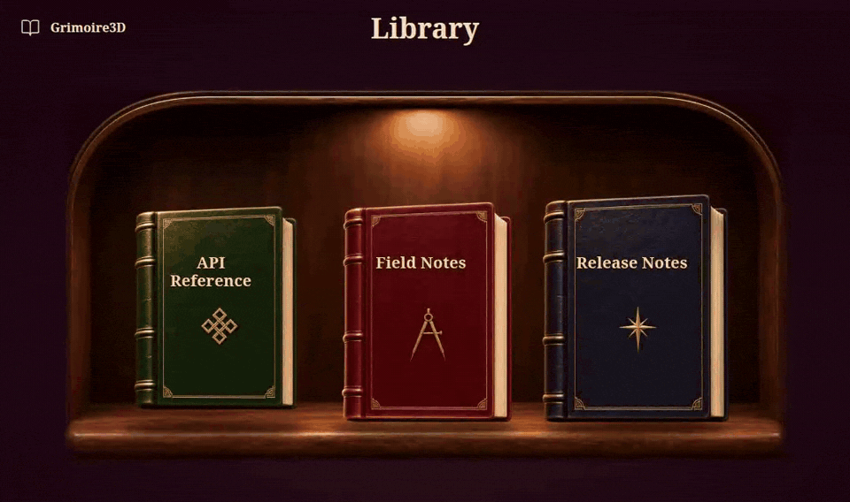

# Grimoire3D

Turn Markdown into 3D books you can open and flip through in a browser.

[](https://www.npmjs.com/package/grimoire3d)



[Read the documentation](https://kkm-horikawa.github.io/grimoire3d/)

## Install

Use a maintained Node.js 22, 24, or 26 release. Install Grimoire3D from npm in the project where you want to write your books. If the project has no `package.json`, run `npm init -y` first.

```sh
npm install --save-dev grimoire3d
```

## Write and preview

Create `docs/field-notes/index.md`.

```markdown
# Field Notes

This is my first 3D book.
```

`docs` 直下の各フォルダが1冊、その中のMarkdownが章になります。`docs` 直下に並べたMarkdownは、まとめて別の1冊になります。入れ子のフォルダは同じ本の章グループです。

```text
docs/
├── index.md                 # docs直下のMarkdownで1冊
├── notes.md
└── field-notes/              # 別の1冊
    ├── index.md              # 本の導入・設定
    ├── setup.md
    └── examples/             # 同じ本の章グループ
        ├── index.md
        └── cli.md
```

各 `index.md` のYAMLに `chapters: [setup.md, examples/]` と書くと、導入の後を指定順に並べられます。未指定の章は後ろにファイル名順で続きます。本が7冊以上、またはカテゴリー・公開日を設定すると検索欄が表示されます。

```sh
npx grimoire3d serve
```

Open the URL printed in the terminal. The preview updates when you save.


## Build and publish

```sh
npx grimoire3d build
```

Deploy the contents of `dist/` to any static host, including Cloudflare Pages and GitHub Pages. Use `--out-dir site` to choose a different output directory.

引用、リスト、チェックリスト、折りたたみ、数式、用語定義、コードの色分け、脚注に対応します。[記述例と実際の表示](https://kkm-horikawa.github.io/grimoire3d/read/writing/formatting/)と、[SEO・YAML設定例](https://kkm-horikawa.github.io/grimoire3d/read/publishing/metadata/)を公式ドキュメントで確認できます。

[Contributing](CONTRIBUTING.md) · [MIT License](LICENSE)
