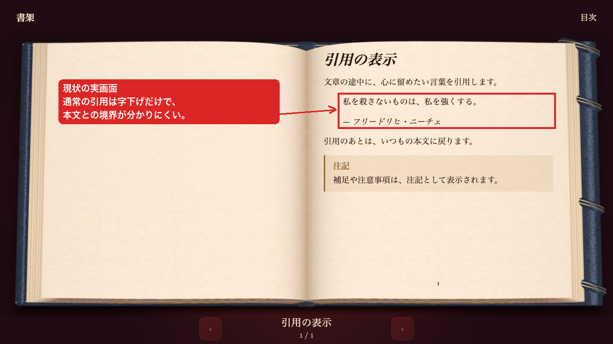
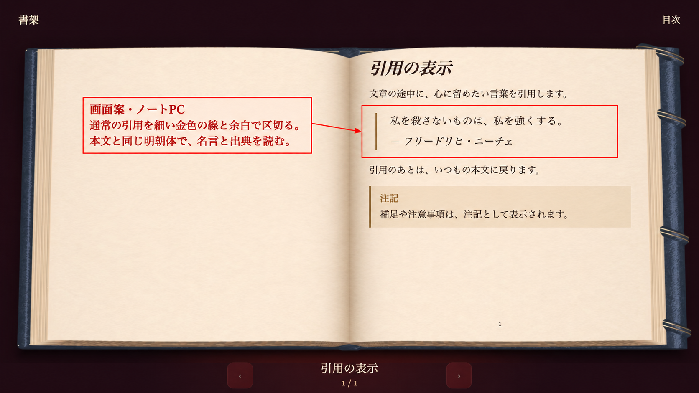
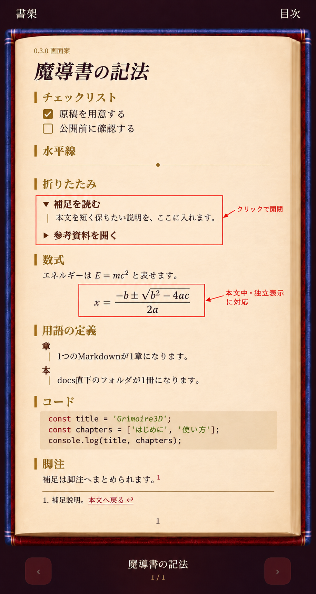

# Recognizing quotes on the paper

Related: [Issue #44](https://github.com/kkm-horikawa/grimoire3d/issues/44). The owner approved the three quote layouts, the remaining markup proposal, and the list proposal on November 20, 2026. They were implemented as part of the v0.3.0 goal.

## Reader experience

The author writes a quotation and attribution using ordinary Markdown. Readers can recognize the quoted passage and continue with the surrounding text.

```markdown
> What does not kill me makes me stronger.
>
> *— Friedrich Nietzsche*
```

## Approved layouts

The generated proposals used screenshots of the existing reader as references. Red boxes, arrows, and callouts are review annotations.

A thin muted gold rule and inset separate a quote from the text. The existing serif type and left alignment support both short quotations and several paragraphs. The paper remains the background. GitHub-style callouts retain their labels, stripe, and shading.

The generated image dimensions are those returned by the image generator. The reference viewport sizes are listed below.

### Laptop

Reference viewport: 1280×720.





### Large monitor

Reference viewport: 1920×1080.


### Mobile

Reference viewport: 390×844.


## Interaction checks

- Recognize a short quote and its attribution as one passage.
- Read long and nested quotes containing emphasis, links, and lists.
- Keep content within the viewport at all three sizes, with long text scrolling inside the paper.
- Render the same source in static HTML and the JavaScript reader.
- Keep callout labels and shading distinct from ordinary quotes.

## Initial markup audit

The original static site was built with the CLI and inspected in a browser.

| Syntax | Behavior before v0.3.0 |
| --- | --- |
| Footnotes | Notes and reference links were generated |
| Task lists | Checkboxes were generated |
| Horizontal rules | Separators were generated |
| Nested quotes | Nested blockquote elements were generated |
| HTML details and summary | Tags appeared as text |
| Math | Dollar-delimited source appeared as text |
| Definition lists | Terms and definitions appeared as plain text |
| Fenced code | Code blocks appeared without language highlighting |

The implementation added paper styling and checked navigation back from footnotes, task-list presentation, and horizontal separators.

## Combined markup proposal

At the owner's request, seven syntax examples were combined into one generated page. The proposal was approved on November 20, 2026.



Shared paper and serif type, gold rules, and spacing identify each element. Task lists display progress recorded by the author. Disclosure headings open with a click or the keyboard. Math supports inline and display equations. Definitions are indented; code uses muted burgundy and olive colors. Footnotes link to notes and back to the original reference.

The version label and red annotations belong to the review image. Actual reader layouts were checked at each viewport width and with realistic content lengths. See the [v0.3.0 plan](v0.3.0.md) for the agreed scope.

## Lists


Bullets and numbers use muted gold with the existing body type. Nested items are indented, and wrapped lines align with the item text. Ordered lists respect the source's starting number and leave enough room for two-digit markers.
