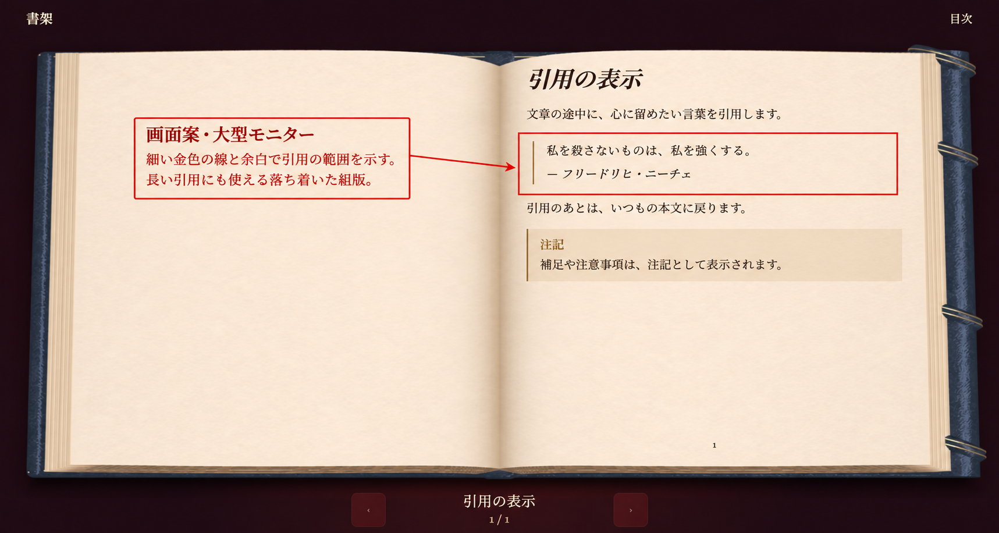
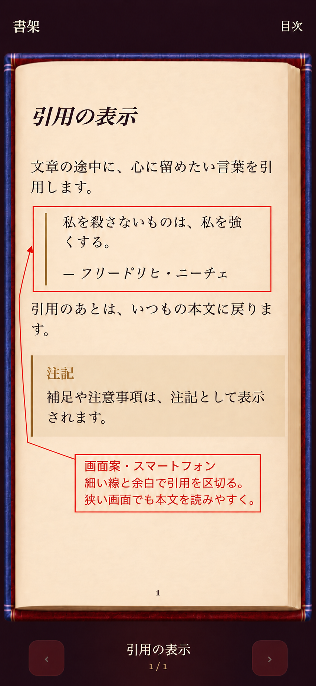
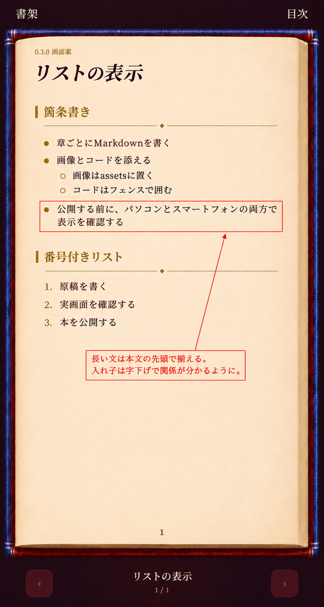

# 通常の引用を紙面で見分ける

関連 [Issue #44](https://github.com/kkm-horikawa/grimoire3d/issues/44)。通常の引用の3サイズ案・残りの記法・リスト案を本人が承認し、0.3.0のゴールに従って実装。

## 読者の体験

書き手が通常のMarkdownの引用に名言と出典を書く。読者は紙面で引用の始まりと終わりを見分け、本文へ読み進める。

```markdown
> 私を殺さないものは、私を強くする。
>
> *— フリードリヒ・ニーチェ*
```

## 画面案

現行画面のキャプチャを参照に画像生成した。各画像の赤枠・矢印・吹き出しは確認用の注釈。

細い落ち着いた金色の左罫線と余白で引用を区切る。既存の明朝体で本文と出典を左揃えにし、短い名言と複数段落の引用をどちらも読めるようにする。背景は紙面を使う。GitHub形式の注記は既存のラベル・帯の表現を使う。

画像のピクセル寸法は画像生成の出力寸法。対応する参照画面幅は下記に示す。

### ノートPC

参照画面は1280×720。


### 大型モニター

参照画面は1920×1080。



### スマートフォン

参照画面は390×844。



## 実装後に確認する操作

- 短い引用と出典が一つの範囲として読み取れる。
- 長い段落、複数段落、入れ子、引用内の強調・リンク・リストが紙面で読める。
- 3画面幅で横にはみ出さず、ページ内の長い内容をスクロールできる。
- 静的HTMLとJavaScript有効の読書画面を、同じMarkdownから確認する。
- GitHub形式の注記は、ラベルと背景の表現を確認する。

## その他のMarkdown記法の現行確認

CLIで静的サイトを生成し、ブラウザで生成HTMLを確認した。

| 記法 | 現状 |
| --- | --- |
| 脚注 `[^one]` | 脚注・参照リンクを生成する |
| タスクリスト `- [x]` | チェックボックスを生成する |
| 水平線 `---` | 区切り線を生成する |
| 入れ子の引用 | 入れ子のblockquoteを生成する |
| HTMLのdetails・summary | タグが本文の文字列として表示される |
| 数式 `$...$` | ドル記号を含む文字列として表示される |
| 定義リスト | 用語・説明の文字列として表示される |
| フェンス付きコード | コードブロックを生成する。言語別のシンタックスハイライトは未対応 |

記法の専用デザインや操作としては、脚注から本文へ戻る操作、タスクリストと水平線の紙面上の見分け方も確認の候補にする。

## 残りの記法の統一案

本人の指定に合わせ、7種類を1ページ・1枚の生成画像にまとめた。2026-11-20に承認済み。


紙面と明朝体を共通にし、金色の線や余白で範囲を示す。チェックリストは書き手がMarkdownに記録した進捗を表示する。折りたたみは見出しをクリック、またはキーボードで開閉する。数式は本文中と独立した表示を扱い、用語の説明は字下げする。コードの色はワイン・緑など紙面に合う控えめな配色にする。脚注は参照先へ移動し、本文の参照元へ戻れるようにする。

画像の「0.3.0 画面案」と赤い注釈は確認用の表記。1枚にまとめた見本から、実際の読書画面では表示幅と内容量に合わせたレイアウトを確認する。

承認後のゴールと文書の追記範囲は [0.3.0の計画](v0.3.0.md)を参照する。

## 箇条書きと番号付きリストの案

両方とも現在のMarkdownで表示できる。以下は紙面に合う配色・余白を整える生成案。



箇条書きの点と番号は落ち着いた金色、本文は既存の明朝体を使う。入れ子を字下げし、長文が折り返した行はリスト本文の先頭へ揃える。リストの数字はMarkdownの開始番号を使い、項目が増えて2桁になった場合も文字と重ならないように確認する。
