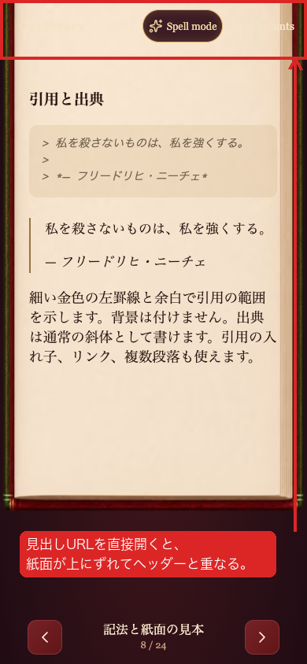
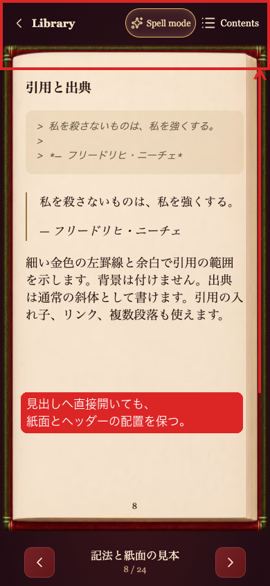
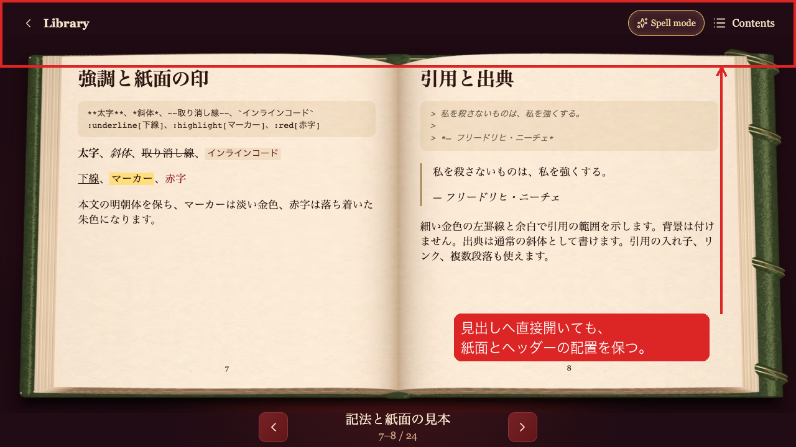
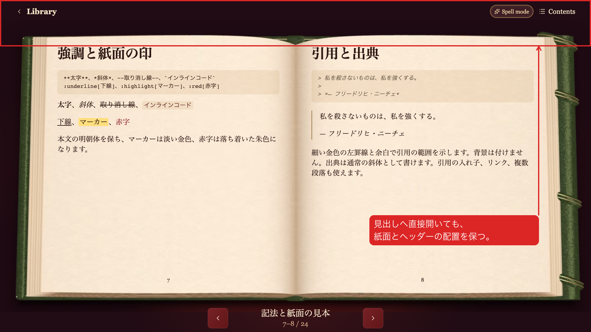

# Paper position when opening a heading URL

[Issue #49](https://github.com/kkm-horikawa/grimoire3d/issues/49). During public verification of v0.3.0, the initial mobile reader acquired a scrollTop of 116px. Version 0.3.1 restores the approved placement.

The outer reader uses overflow:clip instead of overflow:hidden so native fragment navigation cannot scroll the background container. The inner page-text continues to scroll.

Chrome was checked at 1920×1080, 1280×720, and 390×844, with JavaScript on and off. The outer reader's scrollTop stayed zero in all six cases. Footnote focus and return navigation, disclosure keyboard interaction, check, typecheck, 86 tests with coverage, and the build also passed.

