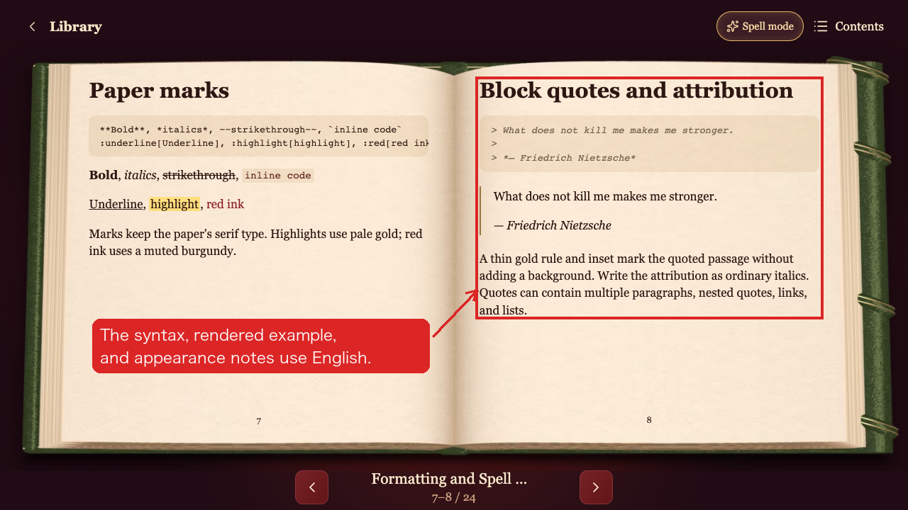
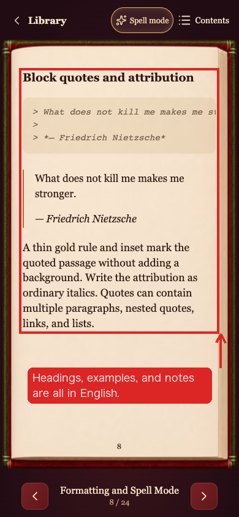
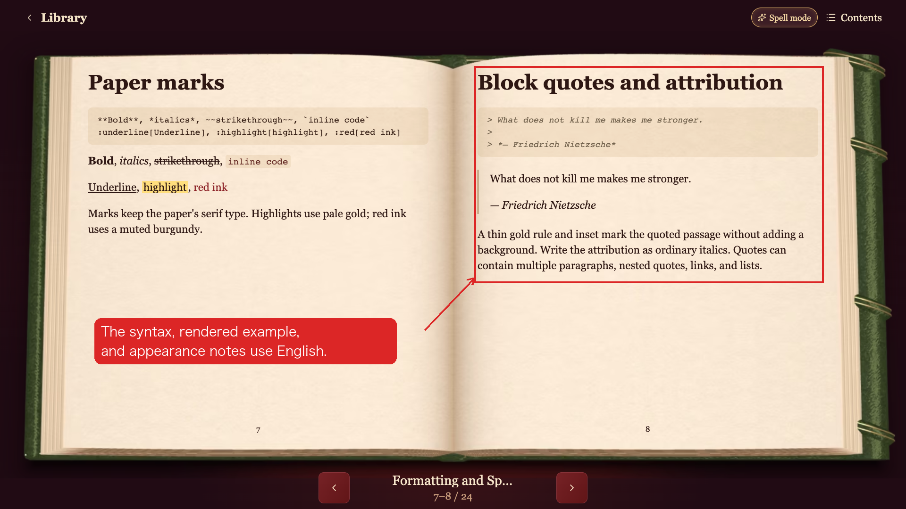

# English public documentation

Issue: https://github.com/kkm-horikawa/grimoire3d/issues/52

The README and all Markdown under website/docs now use English throughout: headings, explanations, metadata, rendered syntax examples, and YAML sample values. Internal development records retain the language in which the work was reviewed.

The examples still show the Markdown source, its rendered result, and a short explanation of its appearance. Book and chapter paths remain unchanged. Existing English anchors for Paper marks, Tables and matrices, and Spell Mode are retained.

Validation: no Japanese text in README.md or website/docs/*.md recursively; check, typecheck, 86 tests with coverage, and production build passed. Chrome at 1920×1080, 1280×720, and 390×844, with JavaScript on and off, kept the reader's outer scrollTop at zero. Footnote focus, disclosure keyboard control, the quadratic formula, and the existing Mermaid diagram were checked.

