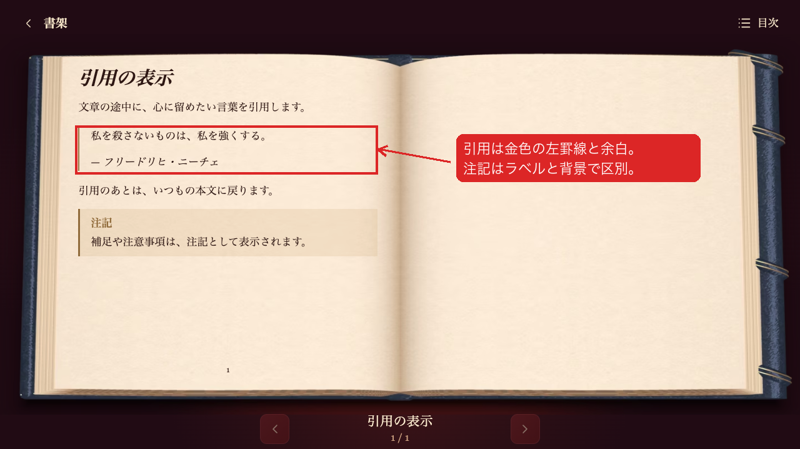
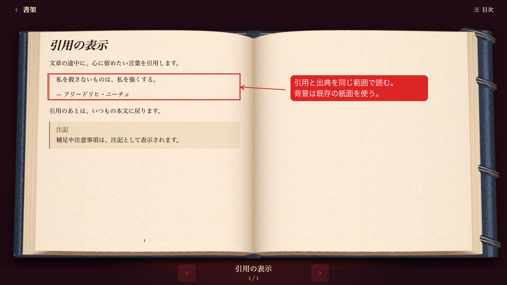
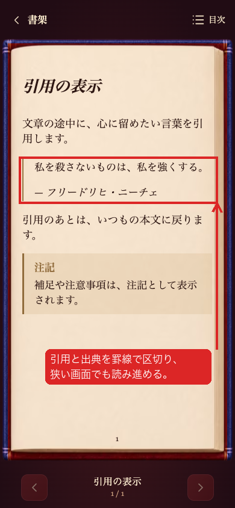
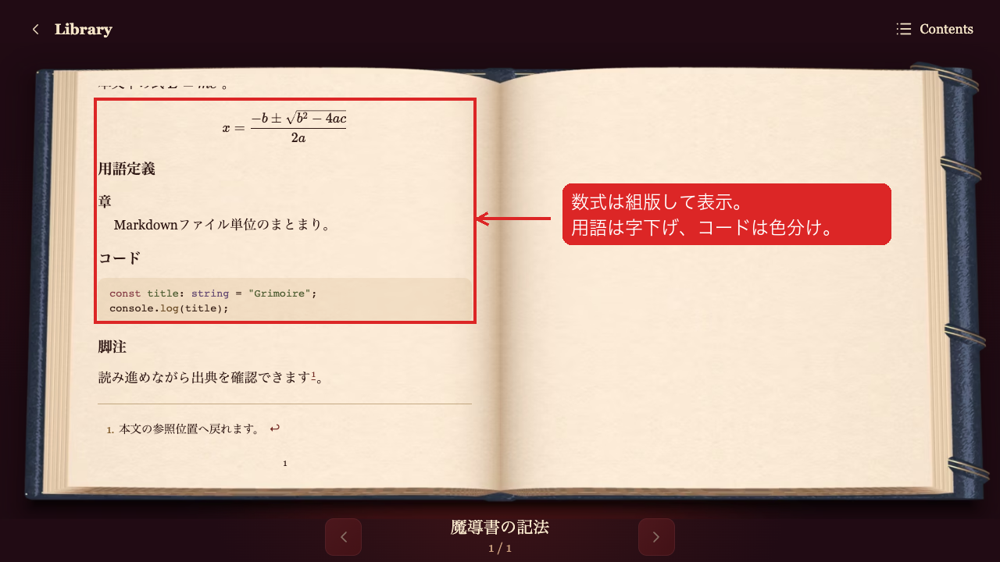
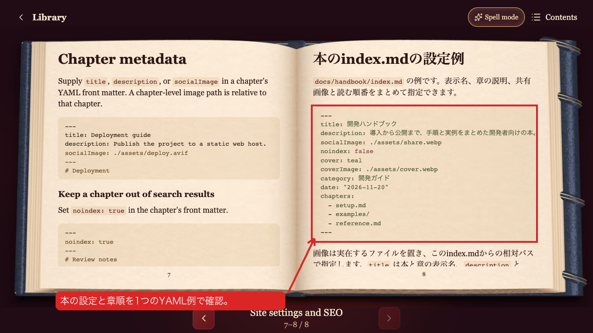

# 0.3.0の表示確認

2026-11-20、Chromeで静的ビルドを開いて確認。1920×1080、1280×720、390×844を使い、それぞれJavaScript有効・無効で実行した。全6条件で画面全体の横はみ出しとJavaScriptエラーはなかった。

- 通常引用の細い罫線・出典・注記との区別を3サイズで確認。
- リストの入れ子、9・10の開始番号、チェックリスト、水平線、用語定義、コードの配色を確認。
- detailsはクリックとEnter・Spaceで開閉。長い内容は紙面内でスクロール。
- 行内数式と独立数式を区別し、JavaScriptなしでも組版を確認。
- 脚注の番号と戻るリンクで紙面内を往復し、章のルートが変わらないことを確認。
- 公式ドキュメントの実際のMarkdownから、数式、YAML設定例、章順を確認。既存のMermaid図も描画を確認。
- check、typecheck、coverage付きの全86テスト、buildに成功。従来のThree.js非推奨・大きいbundleの警告は継続。

## 引用の実画面

## 各記法と公式ドキュメント

生成案はREADME.mdに記録。実装後の元画像は同フォルダの `*-live.png`、`rich-laptop-live-*.png` に残す。
