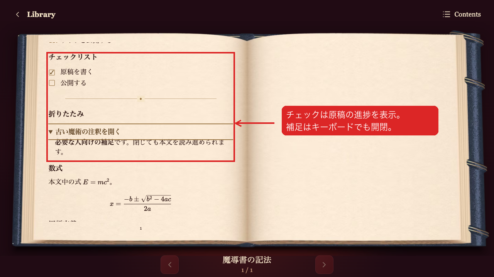

# v0.3.0 rendering checks

On November 20, 2026, the static build was opened in Chrome at 1920×1080, 1280×720, and 390×844, with JavaScript on and off. None of the six cases had viewport-wide horizontal overflow or JavaScript errors.

- Checked quote rules, attributions, and the distinction from callouts at all three sizes.
- Checked nested lists, starting numbers 9 and 10, task lists, horizontal rules, definitions, and code colors.
- Opened details with click, Enter, and Space. Long text scrolled within the paper.
- Checked inline and display math, including rendering without JavaScript.
- Followed footnote references and return links without changing the chapter route.
- Checked long quotes and eight nested quotes on mobile. Japanese chapter paths, Japanese footnote identifiers, and repeated references supported keyboard focus and return navigation with JavaScript on and off.
- Built the actual public guides and checked equations, YAML settings, chapter order, and the existing Mermaid diagram.
- Check, typecheck, 86 tests with coverage, and production build passed. Existing Three.js deprecation and large-bundle warnings remained.

## Quotes

## Markup and public documentation

The approved proposals are recorded in README.md. Original implementation screenshots are retained as *-live.png and rich-laptop-live-*.png in this directory.
