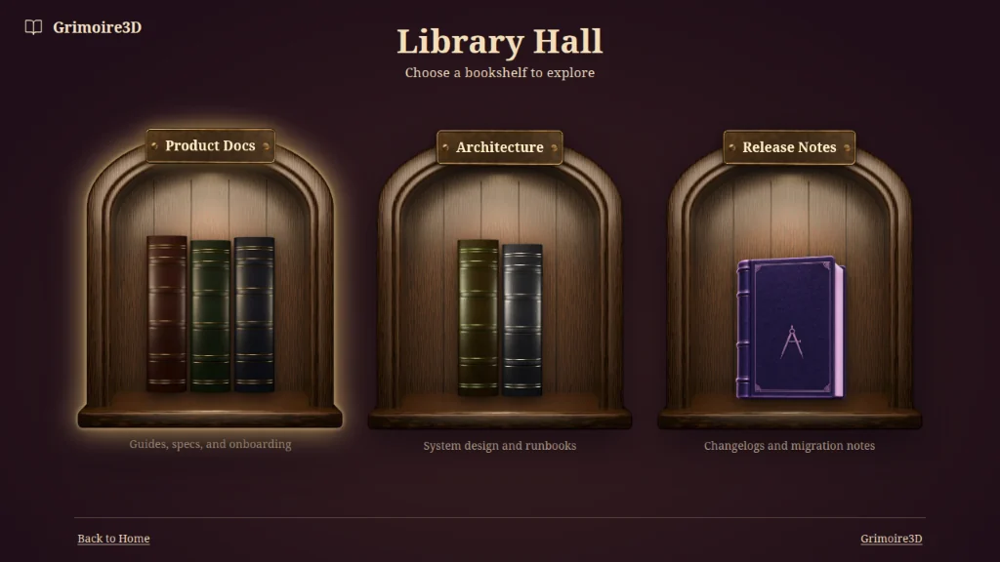

# Multiple bookshelves (Library Hall)

Use `shelves` in `grimoire.yml` when you want distinct bookshelves—such as separate products, teams, or topic areas—rather than grouping books on one shared shelf with `category`.



When `shelves` is present, Grimoire3D generates a **Library Hall** directory at the site root (`/`) and builds each local bookshelf into its own isolated subdirectory (`/<shelf-id>/`). Omit `shelves` to keep the default single-bookshelf behavior unchanged.

## Configure shelves in grimoire.yml

Place a single `grimoire.yml` in your project directory and list each bookshelf under `shelves`.

```yaml
locale: en
title: Library Hall
description: Choose a bookshelf to explore
siteUrl: https://docs.example.com/
footer:
  label: Back to Home
  url: /
shelves:
  - id: product-docs
    title: Product Docs
    description: Guides, specs, and onboarding
    docsDir: ./docs/product
  - id: architecture
    title: Architecture
    description: System design and runbooks
    docsDir: ./docs/architecture
  - id: external-notes
    title: External Notes
    description: Hosted on a separate domain
    href: https://notes.example.com/
    books:
      - title: Release Notes
        cover: plum
```

Each shelf entry accepts these fields:

- `id` (required): lowercase letters, digits, and hyphens (`^[a-z0-9][a-z0-9-]*$`). Reserved names (`assets`, `books`, `content`, `read`, `search`) and duplicates are rejected at build time.
- `title` (required): displayed on the shelf's brass nameplate and used as the child library's site title.
- `description` (optional): short caption displayed below the shelf alcove.
- `docsDir` (optional): path to a local Markdown directory built into `/<id>/`.
- `href` (optional): destination link for an externally hosted bookshelf (HTTP/HTTPS URL or safe relative path). Every shelf must specify `docsDir`, `href`, or both.
- `books` (optional): up to three explicit preview volumes (`title` and optional `cover`) for the alcove. When omitted for a local `docsDir`, Grimoire3D automatically previews up to the first three books from that shelf.

## Isolated output and navigation

Running `npx grimoire3d build` produces a self-contained root Library Hall and independent child bookshelves:

```text
dist/
├── index.html              # Library Hall page (inlined styles, preloaded alcove art)
├── shelves.json            # Machine-readable directory of shelves
├── assets/                 # Shared Library Hall assets
├── product-docs/
│   ├── index.html          # Standalone bookshelf for Product Docs
│   ├── library.json
│   ├── books/
│   └── search/library.json # Isolated full-text index (Product Docs only)
└── architecture/
    ├── index.html          # Standalone bookshelf for Architecture
    └── search/library.json # Isolated full-text index (Architecture only)
```

Each generated child bookshelf automatically receives a footer link back to the hall (`Back to <Hall Title>` → `../`). Full-text search indexes, book JSON files, and attachments stay strictly inside each shelf's directory and never bleed across shelves.

`npx grimoire3d serve` works with the same `grimoire.yml`, serving the Library Hall at `/` and every local shelf at `/<id>/` with live reload.

## Dynamic filtering with shelves.json

If your hosting layer or reverse proxy controls which shelves a visitor may see, intercept requests to `/shelves.json` (`cache: "no-store"`) and return a filtered `shelves` array.

When `/shelves.json` matches the embedded build manifest, static pages keep their server-rendered DOM untouched so initial rendering stays fast. When `/shelves.json` returns a different list (including an empty array), the Library Hall automatically re-renders to show only the permitted shelves or a localized empty message.
