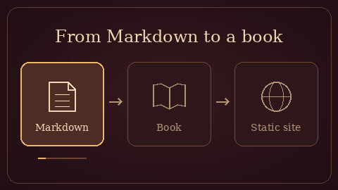
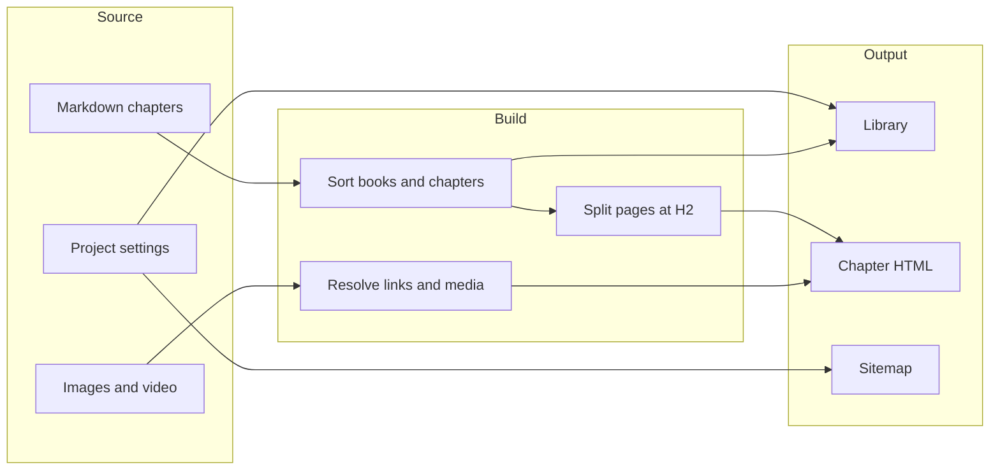

# Images, video, and diagrams

Use Markdown image syntax for still images, animated GIFs, and MP4 files. Resolve local paths from the chapter that uses them. The static build bundles referenced local media.

## Images and GIFs

Use AVIF, WebP, PNG, JPEG, or GIF. Write an alt description inside the brackets.

Click or tap an image in the reader to enlarge it. Zoom in to inspect details, choose **Fit** to see the whole image, or close the viewer to resume reading.

```markdown


```


## MP4

An MP4 renders as a video player inside the page. Playback pauses when you turn away from it.

```markdown

```


## YouTube and Vimeo

Use the video URL in the same syntax. The embedded player loads when the reader selects it. The source link still works when the video owner restricts embedding.

```markdown


```


## Mermaid diagrams

Set the language of a fenced code block to `mermaid`. Select the diagram to open the viewer, then zoom and drag to explore. You can also pan with the arrow keys and press Escape to return to the page.


