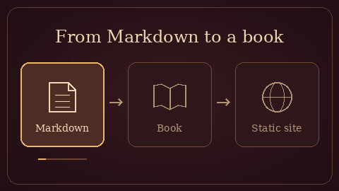

# v1.4

## Added

Markdown projects can be previewed as books and exported to static sites.

### Animated examples

Both examples show how a Markdown project becomes a book and a static site.

#### Animated GIF

#### MP4 video

Press Play to view the animation. This sample has no audio.

## Fixed

Links to chapter headings now stay on the book when it is served from a subdirectory. For existing links, see [the migration guide](./v1.5.md#existing-links).
