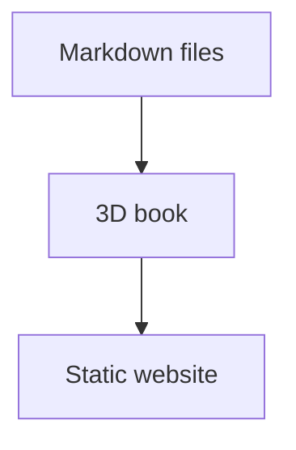
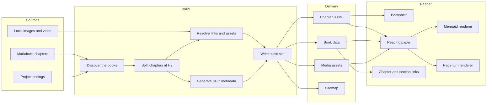

# v1.6

Use **Spell mode** in the header to change the appearance of the paper while you read.

## Paper marks

:underline[Underlined text], :highlight[a highlighted phrase], and :red[red ink] can sit alongside **bold**, *italic*, and `inline code`.

> [!WARNING]
> Keep a copy of the original Markdown when you update a published book.

## Diagrams

## Video players

## Architecture overview

Open the diagram, zoom in, and drag to follow the paths from Markdown to a published book.

